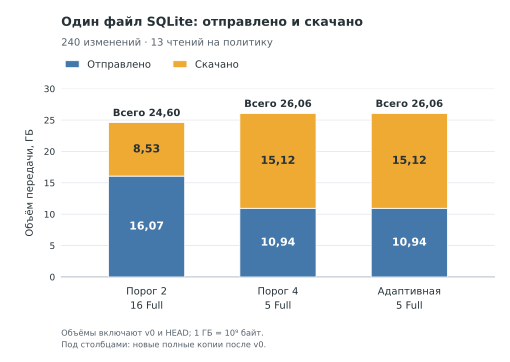
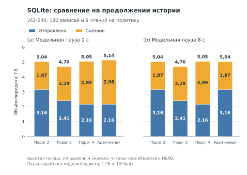
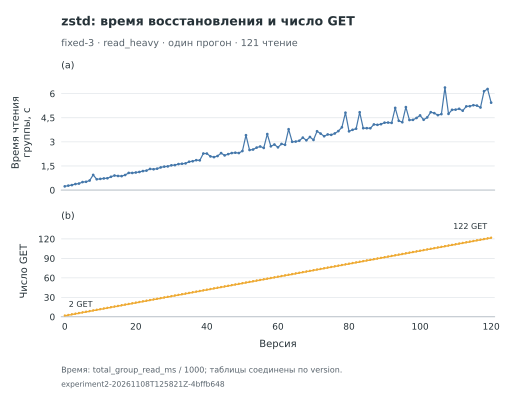

# Результаты стенда

В [реестре](series.csv) одна строка соответствует запуску программы. Поле `series_id` — имя каталога в `raw/`, `monitor_id` — имя каталога в `monitoring/`. Монитор стартует за несколько секунд до приложения и получает собственный ID. Внутри серии одна папка `r01-…` соответствует политике и профилю чтения.

| Измерение                       | Наблюдение                                                                                                                                                                          |
| ------------------------------- | ----------------------------------------------------------------------------------------------------------------------------------------------------------------------------------- |
| E1, один SQLite, версии 0–240   | При чтении через 20 изменений сумма записи и чтения составила 24,604 ГБ для `fixed-2` и 26,059 ГБ для `fixed-4`. `adaptive` выбрал полные копии на тех же версиях, что и `fixed-4`. |
| E2, SQLite, первые 60 изменений | При нулевой паузе модели `adaptive` передал на 6,48% меньше байтов, чем `fixed-2`. Его полная копия на v36 сократила цепочку перед чтением v40.                                     |
| E2, SQLite, продолжение v61–240 | В обоих режимах бюджета `fixed-3` дал 4,699 ГБ против 5,036 ГБ у `fixed-2`. При нулевой паузе `adaptive` дал 5,139 ГБ. Цепочка и остаток бюджета на v60 сохранялись.                |
| E2, zstd, версии 0–120          | Все четыре политики записали одну полную копию, затем 120 дельт. У фиксированных политик суммарно 84,912 МБ при 7 чтениях и 1 227,329 МБ при 121 чтении.                            |
| Служебные данные zstd           | У `fixed-3` за обновления v1–120 передано 3 152 365 байт защищённых дельт и 3 137 711 байт `HEAD.json`. Повторная отправка описания цепочки заняла 49,88% отправки обновлений.      |

ГБ и МБ десятичные. Метрика — сумма тел записанных и прочитанных объектов, включая `HEAD.json`. Задержка и число запросов учитываются отдельно. Итоги можно сверить с [таблицей SQLite](tables/validation-sqlite-61-240-20261108T141301Z.csv) и [таблицей zstd](tables/validation-zstd-0-120-20261108T141313Z.csv).

## Где искать измерение

- `raw/<series_id>/` содержит конфигурацию запуска, среду, статус, общую сводку и каталоги отдельных прогонов. В `writes.csv` записаны оба размера-кандидата, выбранный пакет, число дельт, размер HEAD и модельный бюджет. В `reads.csv` — скачанные байты, GET и SHA-256.
- Во втором эксперименте `preparation.csv` содержит время подготовки данных и упаковки. Полное время чтения группы находится в `group_reads.csv`, столбец `total_group_read_ms`.
- `monitoring/<monitor_id>/` содержит метаданные записи нагрузки и контрольные суммы исходников. Три исходные трассы `sar.csv`, `pidstat.txt` и `iostat.txt` хранятся со сжатием gzip. Их можно читать через `gzip -dc`. Сведения о стенде E1 лежат в `environment-e1/`. Для E1 сохранились снимки среды и консольные логи.
- `tables/` содержит сводки измерений. `calculated/` содержит сценарии, полученные повторным расчётом по наблюдавшимся размерам. Исходные условия основной проверки сохранены в [протоколе v3](../configs/PROTOCOL_THRESHOLD3.json).

В отдельной сводке собрана нагрузка четырёх полных серий. Ограничения числа дельт проверялись дополнительным расчётом по той же истории zstd. [Мониторинг полных серий](tables/monitoring_summary.csv) · [Расчёт для разных лимитов цепочки](calculated/calculated_chain_limits.csv)

В первичном анализе по CSV сверены 39 прогонов и 1 203 восстановления. Для пилотов E1 и zstd v3 при подготовке того анализа была доступна консоль. В реестре указаны также их каталоги на VPS. Трёхшаговые пилоты служили проверкой запуска.

В полных сериях один повтор на условие. Клиент и SeaweedFS находились на одном VPS с 4 vCPU (AMD Ryzen 9 7950X) и 4 ГБ RAM. При чтении создавался новый клиент восстановления, системные кеши сохранялись. Паузы 0 и 8 секунд относятся к виртуальному бюджету. Время отражает работу именно этого стенда. Изолированная стоимость постквантовой защиты потребовала бы отдельного криптографического контроля.

## Графики

1. **Один файл SQLite — сколько отправили и сколько скачали.** Высота в ГБ складывается из суммы `packet_bytes + head_bytes` по записям v0–240 и суммы `download_body_bytes` по 13 чтениям. Источник — `writes.csv` и `reads.csv` каждой политики. График показывает, куда смещаются расходы при более редких полных копиях.

2. **SQLite — сравнение на продолжении истории.** По оси X четыре политики, по Y сумма переданных байтов в ГБ. Две панели для модельных пауз 0 и 8 с. В каждом столбце отдельно выделить `upload_body_bytes` и `download_body_bytes`. Источник — таблица SQLite для v61–240. 

   

3. **zstd — восстановление по мере накопления дельт.** По X версия 0–120. В верхней панели время чтения группы в секундах (`total_group_read_ms / 1000`), в нижней — число GET. Показывает, сколько операций потребовала каждая цепочка и сколько заняло её восстановление.

   
